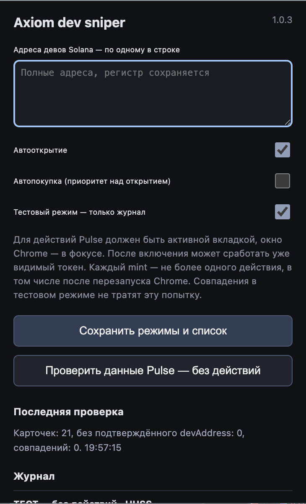

# Axiom dev sniper

**Версия 1.0.3 · Chrome · Axiom Pulse / Solana**

Отслеживает указанные dev-адреса в карточках Pulse и автоматически открывает или покупает подходящие токены.

## Возможности

- Список полных Solana dev-адресов, по одному в строке.
- Независимые автооткрытие и автопокупка; при совпадении обоих режимов приоритет у покупки.
- Тестовый режим: только журнал совпадений, без действий.
- Проверка видимых данных Pulse вручную и журнал результатов.
- Защита от повторного действия по одному mint между вкладками и перезапусками Chrome.

## Настройки

Добавьте dev-адреса с сохранением регистра, выберите режимы и нажмите **Сохранить режимы и список**. По умолчанию OPEN и BUY выключены, а тестовый режим включён. Для реальных действий отключите тестовый режим.

Кнопка **Проверить данные Pulse — без действий** выполняет разовую диагностику; включённые автоматические режимы продолжают работать независимо от этой кнопки.

## Установка

1. Скачайте ZIP репозитория через **Code → Download ZIP** и распакуйте его.
2. Откройте `chrome://extensions` и включите **Режим разработчика**.
3. Нажмите **Загрузить распакованное расширение** и выберите папку с `manifest.json`.
4. Обновите вкладку Axiom. Настройки открываются нажатием на значок расширения в Chrome.

Сборка и установка npm-зависимостей не требуются. После обновления файлов перезагрузите расширение на странице `chrome://extensions` и обновите Axiom.
